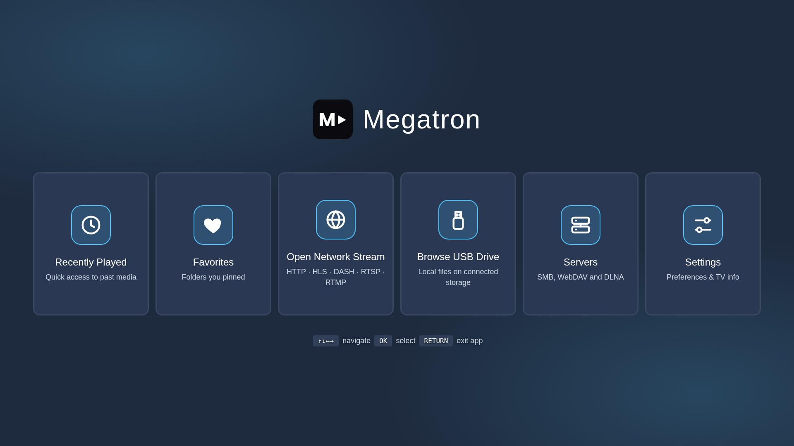
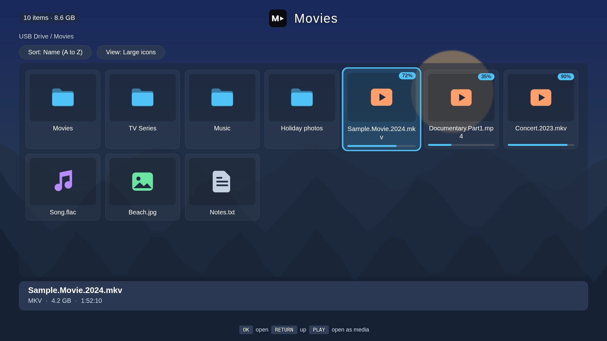
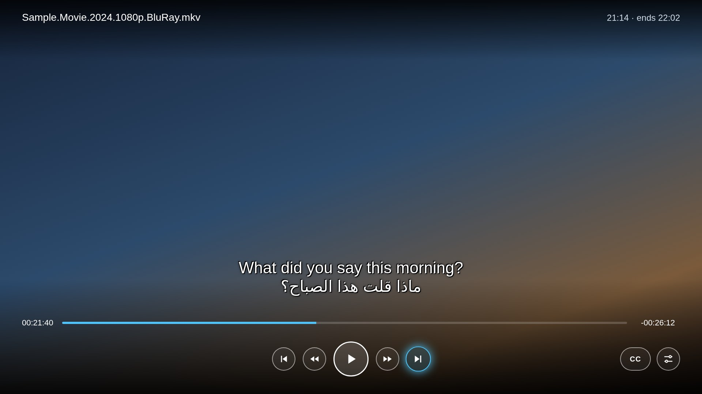
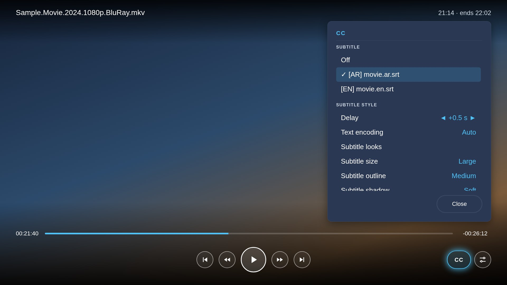
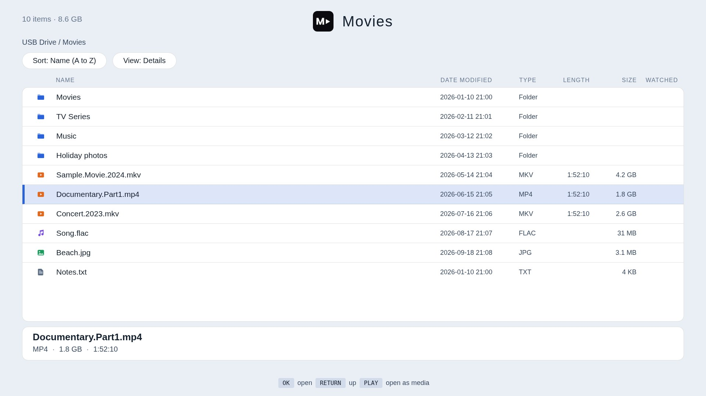
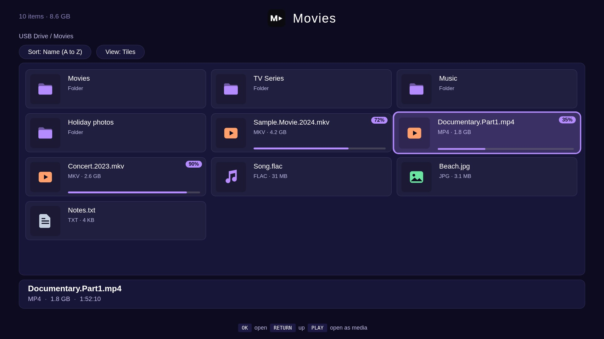
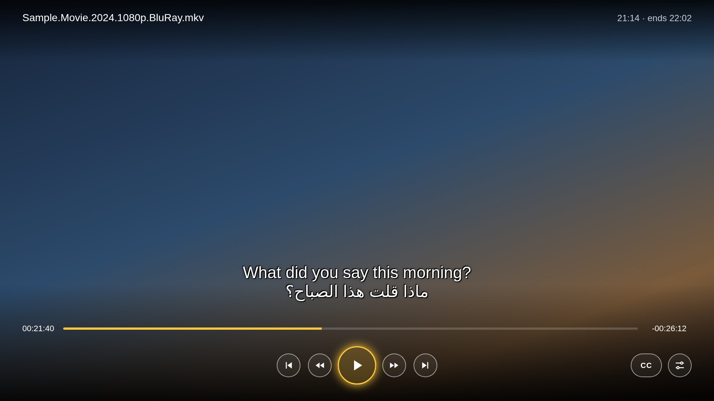
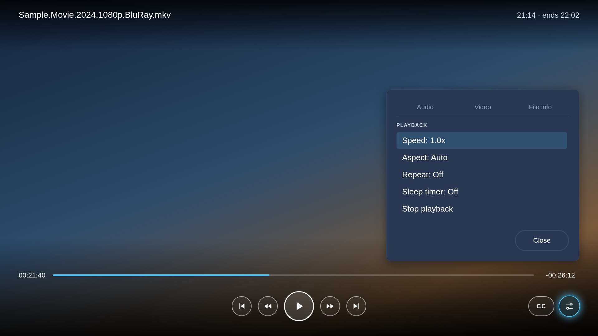
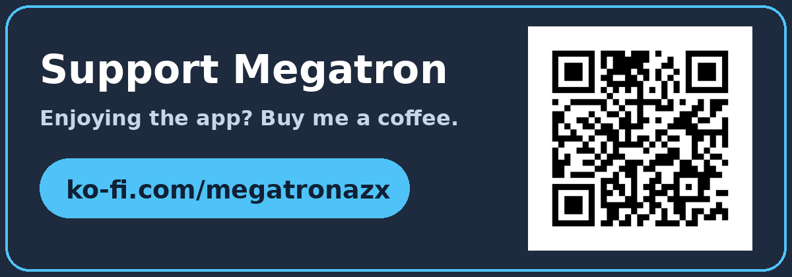
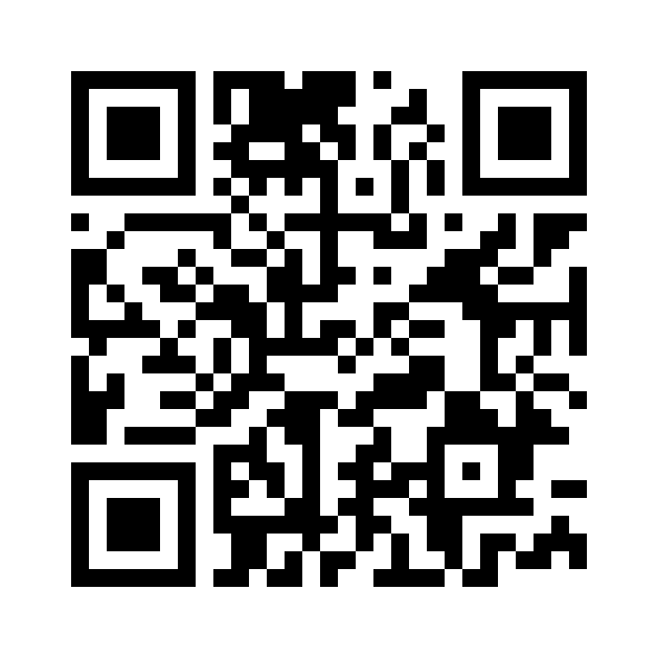

# Megatron

**A media player for Samsung Tizen TVs with Explorer-style folder views.** Play videos, music and photos from a USB drive, SMB shares, DLNA servers, WebDAV and network streams, with hardware-accelerated playback through Samsung's AVPlay.

Megatron is a fork of [Tessel](https://github.com/PatrickSt1991/tessel-tizen-tv) by Patrick (MIT licensed). It keeps everything Tessel does and adds a nicer way to browse a big USB drive.

<p align="center">
  
  
</p>
<p align="center">
  
  
</p>

*The pictures are screens rendered from the app's own styles and shown on a TV frame, with sample file names.*

## Main features

**Browse like Windows Explorer**
- Five folder views: Large icons, Small icons, Tiles, List and Details (name, date, type, length, size, watched). Views, the Sort / View bar and the info bar work on USB, SMB, WebDAV and DLNA.
- Sort by name, date, size or type, ascending or descending. Folders stay on top and episodes sort naturally (E2 before E10).
- **Watched percentage on every video**: a progress bar and a "72%" badge on each tile, a ✓ when finished, a "Watched" column in Details, and the file you left off at is selected when you come back.
- **Fan art behind folders**: a folder's fan art (`fanart.jpg`, `backdrop.jpg`, `background.jpg`) shows softly behind the list. Set it to Off, Subtle or Strong.
- **Poster covers** for folders (`poster.jpg`, `folder.jpg`, `cover.jpg`), real thumbnails for photos loaded as you scroll, and clean line icons.
- An info bar for the highlighted file (type, size, date, length, watched), an item count and total size, and hold OK on a file for a menu (Favorites, forget watched).

<p align="center">
  
  
</p>

**Looks you can change**
- **Ten themes**: Dark, AMOLED black, Light, Midnight, Forest, Warm light, High contrast, Baby blue, Grey, Black and white.
- **Twelve accent colours** and three text sizes.
- **Backgrounds**: the plain theme colour, a soft **Aurora** glow, or **your own picture** (hold OK on any photo in the file browser and choose "Use as background").
- Pick the folder view and sort order once; the TV remembers it.

<p align="center">
  
</p>

**A new player**
- Glass-outline buttons with a glowing focus ring, a progress bar with elapsed and remaining time (select the time on the right to switch between total and remaining), and an "ends at" clock.
- Separate panels: **CC** opens subtitles, the gear opens Audio, Video and File info.
- Skip length you choose (5, 10, 15, 20, 30 seconds or your own value), a next-episode box with Skip, and a sleep timer (minutes or end of item).

<p align="center">
  
</p>

**Better subtitles**
- Automatic choice by language, with a second fallback language (.srt preferred over .ass, forced and SDH tracks last).
- Subtitles lift above the player bar while it is showing, so they are never covered.
- Delay per video (adjust in steps from half a second), a text encoding picker (fixes Arabic and other scripts), outline, shadow and opacity, and saved looks: Movie, Large and bold, Minimal, High contrast, and your own.
- Delay works on subtitles the app draws itself (sidecar files and text tracks). There is no audio delay: Samsung's player does not offer one.

**More**
- Network access setting: Everything, only servers you set up, or nothing.
- Arabic translation of all Megatron screens, alongside Tessel's other languages.
- Installs next to Tessel with its own app ID, name and icon.

Limits: SMB, WebDAV and DLNA servers do not report a modified date, so the Date column is empty there and sorting by date falls back to name. Video thumbnails are planned for later.

## Everything from Tessel (still included)

- **Plays almost anything the TV can decode** — H.264 / HEVC / VP9, AAC / MP3 / AC3 / EAC3, HLS / DASH / RTSP / RTMP
- **USB, internal storage and SMB shares**, **DLNA media servers**, **WebDAV servers**, all in one Servers tile
- **Music that plays on while you browse**, with tags, cover art and a mini-player
- **Pictures, text and playlists** — photo viewer with slideshow, text viewer, M3U / PLS lists (IPTV channels grouped by category)
- **Cast a URL from your phone** by scanning a QR code
- **Subtitles** — SRT / VTT / ASS / SAMI / MicroDVD sidecars and embedded MP4 / MKV tracks, with adjustable size, font, colour, weight, position and background
- **Resume or start over**, watched marks, and recent history
- **Transcode server** for files the TV can't decode (DivX, DTS, TrueHD) — see [transcode-server](transcode-server/). This part is inherited from Tessel and has not been re-tested under Megatron's new app ID.
- **INFO key** shows codec, picture size, bitrate, HDR type and tracks

## Install

1. **Developer Mode** on the TV: Apps → press `1 2 3 4 5` → Developer Mode **ON** → enter your PC's IP → restart the TV.
2. Download `megatron.wgt` from [Releases](../../releases).
3. **Easy:** install [Apps2Samsung](https://github.com/Apps2Samsung/Apps2Samsung/releases/latest), connect to your TV and install the `.wgt` as a local file. It signs the app for your TV.
4. **Manual:** re-sign the `.wgt` with your own distributor certificate in Tizen Studio, then:

   ```bash
   sdb connect <tv-ip>
   sdb install megatron.wgt
   ```

The release `.wgt` is signed with a generic CI certificate and will not match your TV's DUID until it is re-signed.

Requires a Samsung Tizen TV (2017 or later; SMB, DLNA and WebDAV need Tizen 4.0+, 2018 and later). Developed with a 2024 Crystal UHD DU7000 as the test TV.

## Building

```bash
bash tizen-app/build.sh      # unsigned .wgt in dist/
```

Needs Node.js and a Bash shell (Git Bash on Windows). Releases are published by hand; the version lives in `tizen-app/config.xml`.

## Docs

Most docs come from Tessel and still say "Tessel"; the instructions apply to Megatron too.

- [Playback notes](docs/PLAYBACK-NOTES.md) — files the TV can't decode, 5.1 that comes out as stereo
- [Transcode server](transcode-server/README.md)
- [Cast from another device](docs/SEND-URL-FROM-DEVICE.md)
- [Megatron Send, phone apps for Android and iOS](https://github.com/Megatro-nn/megatrontizentv-send-to)
- [Files onto the USB stick from your PC](docs/REMOTE.md)
- [Reading the app's log](docs/DEBUG-LOG.md)
- [Why a web app and not native](docs/WHY-WEB-APP.md)

## Roadmap

Ideas for later. None of these are promised, and the order can change.

**On the TV**
- A "Continue watching" row on the home screen.
- Auto next episode with a countdown.
- Subtitle search on the TV when a video has none.
- Audio language memory per show.
- A PIN lock for chosen folders.
- A fully mirrored right-to-left layout for Arabic.
- Movie and show poster covers from the web (optional).
- Video thumbnails.

**Send to Megatron (phone)**
Done already: the [Megatron Send apps](https://github.com/Megatro-nn/megatrontizentv-send-to) for Android and iPhone, and a link queue and "Recently sent" list on the send page.

Still ideas:
- Settings backup and restore as one file from the phone page.
- An iOS Shortcut for the Share menu.

## Translations

The app follows the TV's menu language, or *Settings → App language*. Every string lives in `tizen-app/i18n/<locale>.json`; `en.json` is the source and missing keys fall back to English. Arabic is complete for Megatron's new screens; other languages show the new strings in English until translated. Translations are welcome as pull requests.

## Support

If Megatron is useful to you, you can support its development on Ko-fi: **[ko-fi.com/megatronazx](https://ko-fi.com/megatronazx)**

<p align="center">
  <a href="https://ko-fi.com/megatronazx"></a>
</p>
<p align="center">
  
</p>

## Credits and license

Megatron is a fork of **[Tessel](https://github.com/PatrickSt1991/tessel-tizen-tv)** by Patrick ([@PatrickSt1991](https://github.com/PatrickSt1991)), the Samsung Tizen TV player that was called VLC TV before version 1.7.0. The player core, the SMB, DLNA and WebDAV browsing, the transcode server, the viewers and most of the documentation come from Tessel. Thank you to Patrick for building it and sharing it under the MIT license.

Megatron is written by [Megatro-nn](https://github.com/Megatro-nn).

Built on Samsung's AVPlay API. This is an independent project, not affiliated with or endorsed by Samsung, VideoLAN or the Tessel author. Samsung and Tizen are trademarks of their owners.

MIT licensed. See [LICENSE](LICENSE): it keeps Tessel's original copyright notice ("Copyright (c) 2026 Patrick") together with the Megatron changes, as the MIT license requires.
